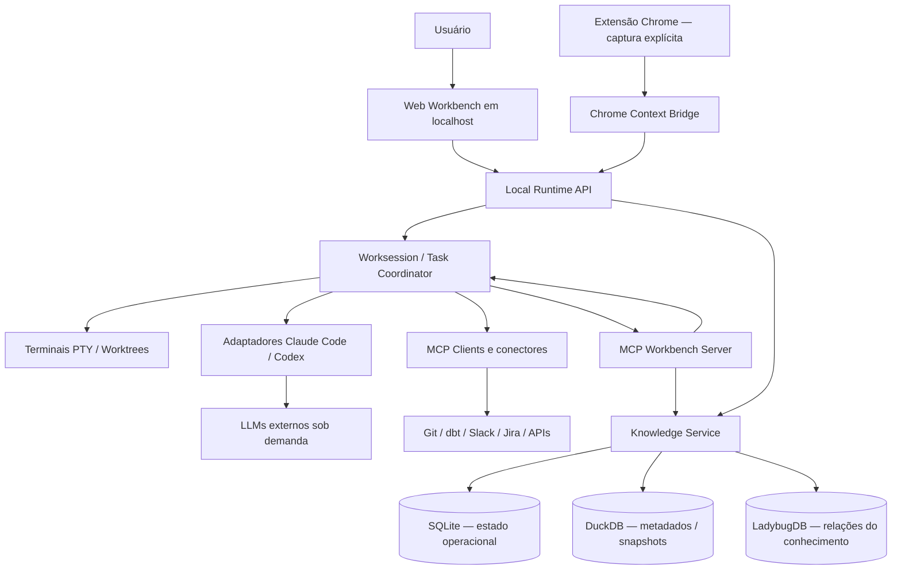

# Agentic Workbench

> **Nome de trabalho:** Context-Aware Agentic Workbench  
> **Estado:** preview local 0.1.0 implementado; V1 completa em desenvolvimento  
> **Foco inicial:** Analytics Engineering; arquitetura genérica para outros tipos de trabalho.

## Executar o preview

Requer **Node.js 24+**, npm, Git e ferramentas de compilação para `node-pty`.

```bash
npm ci
npm run demo  # opcional: três repositórios fictícios
npm run dev
```

Abra **http://127.0.0.1:5173** e use o código de pareamento exibido no terminal do runtime.

O primeiro incremento implementa projetos, repositórios, terminais reais, sessões persistidas, MCP, busca read-only entre repositórios, conhecimento com evidências e leitura de metadados Git/dbt. A busca delegada é determinística e não usa LLM. Integrações programáticas de agentes, DuckDB/Ladybug e Chrome/Jira ainda estão pendentes.

- [Guia de execução, demo e configuração MCP](docs/GETTING_STARTED.md)
- [Estado detalhado e próximos tickets](docs/IMPLEMENTATION_STATUS.md)
- Verificação: `npm test`, `npm run lint`, `npm run format:check`, `npm run build`.
- Interface compilada: `npm run build && npm start` → **http://127.0.0.1:4317**.

A visão e o plano originais continuam abaixo como especificação do produto.

## Visão

O **Agentic Workbench** é um ambiente de trabalho **local-first** que conecta projetos, conhecimento de negócio, repositórios, sessões de agentes e aplicações externas. Seu propósito é reduzir o esforço de alternar entre ferramentas, transportar contexto manualmente e reconstruir o entendimento de uma demanda em cada conversa com IA.

Não pretende substituir VS Code, Git, dbt, Slack ou Jira. Deve permitir **trabalhar com essas ferramentas de maneira coordenada**, por meio de uma interface web local, terminais integrados, agentes externos (Claude Code e Codex) e um servidor MCP próprio.

**Princípio orientador:** *o conhecimento é transversal; os projetos têm objetivos; as worksessions executam trabalho; os agentes conectam as ferramentas.*

## O problema

Uma demanda de Analytics Engineering frequentemente atravessa:

- discussões e decisões no Slack, Confluence e Drive;
- atividades e critérios de aceite no Jira;
- múltiplos repositórios com dbt Core, Dataform, Airflow, SQL e Python;
- agentes especializados com `CLAUDE.md`, `AGENTS.md` e outras instruções locais;
- estruturas de dados, modelos, DAGs, dependências e histórico Git.

Hoje, boa parte do contexto é transportada manualmente: copiar threads, abrir vários terminais, repetir explicações, localizar a mesma regra de negócio e coordenar alterações entre repositórios.

O Workbench busca transformar esse fluxo em **trabalho contextual, delegado e rastreável**, com aprovações humanas e custo controlado.

## O que o produto é — e o que não é

**É:**

- uma **interface web local** para projetos, tarefas, terminais, sessões e contexto;
- um **runtime local** para execução e coordenação de agentes;
- um **servidor MCP** que expõe contexto e delegação a Claude Code, Codex e clientes compatíveis;
- uma **camada de conhecimento** com evidências e relações entre conceitos, decisões, documentos e código;
- uma **ponte entre aplicações**, preferindo APIs/MCPs autorizados e usando o Chrome atual para capturar o contexto da página aberta.

**Não é:**

- um editor de código completo ou substituto obrigatório do VS Code;
- um data warehouse ou substituto do dbt/Dataform/Airflow;
- uma LLM hospedada localmente: **a inferência usa provedores externos**;
- um observador irrestrito de todas as abas, mensagens e arquivos;
- um agente com autorização permanente para alterar produção, Jira ou repositórios.

## Conceitos de domínio

| Conceito | Definição | Observação |
|---|---|---|
| **Domain** | Área semântica de negócio, por exemplo Payments ou Finance | Compartilha conhecimento com muitos projetos |
| **Knowledge Item** | Conceito, regra, métrica, decisão ou hipótese | Tem escopo, validade, evidência e estado de validação |
| **Evidence** | Fonte verificável de uma afirmação | Link, identificador, versão, trecho autorizado e momento da coleta |
| **Project** | Iniciativa com objetivo e recursos associados | Pode ser finita (*migração*) ou contínua (*governança*) |
| **Task** | Trabalho executável, possivelmente distribuído | Pode ter dependências, aprovações e múltiplas sessões |
| **Resource** | Objeto referenciado: repo, arquivo, modelo, DAG, thread, card, documento | Um recurso pode estar em vários projetos |
| **Worksession** | Sessão de trabalho vinculada a um repositório ou ambiente | Possui agente, `cwd`, instruções, permissões e histórico |
| **Delegation** | Solicitação de uma worksession a outra | Assíncrona, rastreável, limitada e inicialmente somente leitura |
| **Subscription** | Acompanhamento de uma fonte ou evento | Planejada para depois da V1; não implica IA rodando continuamente |

**Regra de modelagem:** não colocar todo o conhecimento “dentro” de um projeto. Uma regra de TPV pode atender simultaneamente a uma migração, uma análise pontual e um workspace contínuo. Projetos **referenciam** conhecimentos e podem produzir propostas de evolução.

## Jornadas de uso

### A. Colaboração entre repositórios

1. O usuário abre o projeto **Migração Dataform → dbt**, ligado a três repositórios: dbt, Dataform e Airflow.
2. Inicia uma worksession para cada repositório; cada agente carrega as instruções da própria pasta (`CLAUDE.md`/`AGENTS.md`).
3. Na sessão dbt, pede: “Investigue se essa alteração exige mudanças no Airflow”.
4. O agente usa o MCP do Workbench para solicitar uma investigação **somente leitura** ao especialista Airflow.
5. O coordenador entrega a tarefa à worksession correta (ou cria uma sessão isolada autorizada), registra estado e devolve descobertas com referências a arquivos e logs.
6. Havendo mudanças a fazer, o Workbench apresenta um plano para aprovação; eventuais implementações usam worktrees/branches separadas.

### B. Da thread à demanda, sem copiar e colar

1. O usuário está lendo uma thread do Slack no **Chrome atual**.
2. Usa a extensão: **“Associar esta thread ao projeto”** ou **“Preparar demanda no Jira”**.
3. A ponte local captura o identificador/URL e conteúdo autorizado da aba; com permissões, a API do Slack complementa a conversa.
4. Um agente interpreta a demanda **sob solicitação**, busca regras conhecidas e prepara um rascunho de Jira.
5. O usuário revisa e aprova a criação/atualização; o Workbench mantém referências entre thread, tarefa, projeto e evidências.

> Integrações corporativas dependem da autorização da organização. Sem acesso aprovado à API do Slack, o protótipo deve informar suas limitações e jamais contornar controles corporativos.

### C. Conhecimento que ultrapassa projetos

1. Uma investigação identifica uma possível exceção na regra de reconhecimento de receita.
2. O agente registra uma **afirmação candidata**, com escopo, fonte e evidências.
3. Um usuário valida ou rejeita a proposta; nada vira “verdade organizacional” apenas porque um agente afirmou.
4. Outros projetos passam a recuperar a regra validada, inclusive após o encerramento da investigação original.

## Experiência de interface

**Tela principal minimalista**, evitando dashboards densos:

- **Barra lateral:** Projetos, Knowledge, Workspaces, Atividade;
- **Área central:** uma visão ativa por vez — projeto, tarefa, terminal, metadados dbt ou conhecimento;
- **Painel contextual opcional:** evidências, vínculos, dependências, aprovações e status da execução;
- **Command Center:** caixa de comando global para pedir ações entre ferramentas.

O terminal é integrado, mas **não inclui editor SQL avançado na V1**. Um arquivo pode ser aberto no editor externo instalado.

## Arquitetura lógica



### Contratos entre componentes

- **`runtime-api`**: CRUD de projetos/recursos/tarefas/sessões, eventos e aprovações; interface só acessa por API local autenticada.
- **`session-manager`**: PTY, `cwd`, estado de processo, sessões dos provedores, abertura/encerramento; nunca depende de comandos digitados artificialmente no terminal para delegar tarefas.
- **`task-coordinator`**: fila persistente, estados, idempotência, dependências, limites e correlação origem/destino.
- **`agent-adapters`**: adaptadores independentes para Claude Code e Codex; PTY para uso interativo, APIs/SDKs oficiais para execução controlada quando possível.
- **`mcp-workbench`**: acesso a contexto e solicitação/consulta de tarefas entre worksessions.
- **`integrations`**: conectores existentes (MCP/API/CLI) com políticas por recurso, em vez de implementação proprietária para tudo.
- **`knowledge`**: registro de evidências, relações explicitamente validadas e índices locais reconstruíveis.

### Persistência local

- **SQLite:** fonte transacional de projetos, worksessions, tarefas, eventos, aprovações e fila/outbox.
- **DuckDB:** inventário e snapshots de metadados estruturados (por exemplo, `manifest.json` do dbt, resultados de análise e estruturas de tabelas).
- **LadybugDB:** grafo de conceitos, recursos e relações com proveniência/estado; **não** é a fila de tarefas.

Para evitar *dual writes*, eventos confirmados no SQLite alimentam projeções idempotentes nos outros bancos. Em caso de falha, as projeções são reprocessadas; nenhuma transação distribuída entre bancos é presumida. **A integração completa DuckDB + Ladybug depende de um teste técnico curto na V1.**

## Ferramentas e tecnologias candidatas

| Área | Escolha inicial | Justificativa |
|---|---|---|
| UI | React + TypeScript + Vite | Interface local simples e modular |
| Runtime | Node.js + TypeScript | PTY, processos, integrações e MCP no mesmo ecossistema |
| Terminal | xterm.js + node-pty | Shell interativo real, sem criar editor |
| Operações locais | Git CLI / dbt Core CLI + leitura de artefatos | Controle explícito e metadados sem tokens |
| dbt | `manifest.json` + dbt MCP oficial | Inventário, lineage, compilação/testes sob aprovação |
| Agentes | Claude Code + Codex | Provedores externos sem inferência local |
| MCP | MCP SDK + MCPs oficiais de terceiros | Reuso de integração sem gateway obrigatório |
| Estado operacional | SQLite | Persistência simples, transacional, local |
| Metadados analíticos | DuckDB (`@duckdb/node-api`) | Consultas e snapshots locais |
| Grafo | LadybugDB (`@ladybugdb/core`) | Relações tipadas e travessias com Cypher |
| Navegador | Extensão Chrome Manifest V3 + Native Messaging (a validar) | Captura da aba atual com autorização |

**Gateway MCP:** opcional. Avaliar Docker MCP Gateway ou ContextForge quando a administração dos conectores justificar o custo operacional. Não construir o Workbench sobre uma dependência exclusiva de gateway.

## Escopo V1

A V1 deve provar uma experiência utilizável, não cobrir todos os recursos imaginados.

**Incluído:**

1. Aplicação web local e runtime, com login/pareamento local e sessão do usuário.
2. Projetos finitos/contínuos, com associação de múltiplos repositórios e recursos.
3. Terminal interativo com worksessions, `cwd`, instruções próprias e histórico de execução do Workbench.
4. Integração interativa com Claude Code e Codex; **pelo menos um** adaptador programático completo (retomada, delegação, status); o outro pode começar com terminal PTY.
5. MCP próprio com consulta de contexto e delegação **somente leitura** entre repositórios.
6. Integração nativa mínima com Git, dbt Core (`manifest.json`) e exploração básica de linhagem.
7. Conhecimento mínimo: entidades, relações, evidências, status de validação e recuperação pelos agentes.
8. Extensão Chrome para captura **explícita** da página/thread aberta, associação a projeto e rascunho de tarefa Jira; publicação apenas após aprovação e quando a integração estiver autorizada.
9. Logs de execução, limites por tarefa e permissões restritas.

**Fora da V1:** editor completo, execução automática em produção, DAGs Airflow em tempo real, sincronização permanente de todas as fontes, monitoramento contínuo de threads, banco vetorial obrigatório, plugins autogerados, auto-modificação do produto, coordenação de centenas de agentes, SaaS multiusuário e conexão nativa obrigatória com BigQuery.

## Segurança e custo como princípios de projeto

- **Local-first ≠ offline ou dados sempre locais**: Claude/Codex recebem contexto selecionado na nuvem. Documentar escopo e consentimento antes do envio.
- Ler conteúdo do Slack/web como **dados não confiáveis**, nunca instruções executáveis; usar proteção contra *prompt injection* e confirmação para ferramentas com efeitos.
- `read_only` por padrão; operações destrutivas, escritas, PRs, Jira e comandos perigosos exigem autorização explícita.
- **Menor privilégio:** políticas por origem, agente, projeto, ação e diretório; credenciais em armazenamento seguro do sistema operacional.
- Nenhuma captura passiva global do Chrome; acessos a páginas devem ser acionados pelo usuário e limitados a domínios permitidos.
- Sessões ociosas e monitoramento de mudanças **não** disparam inferência; só acionar LLM por comando ou evento aprovado.
- Tarefas precisam de limite de delegações, tempo, orçamento e evidências de execução; registrar uso de tokens quando reportado pelo provedor e sinalizar estimativas quando não reportado.
- Com o computador desligado/suspenso, serviços locais param; a V1 não promete execução em background remoto.

## Organização proposta do monorepo

```text
agentic-workbench/
├── apps/
│   ├── web/                 # dashboard React
│   ├── runtime/             # API, sessão, coordenação e filas locais
│   └── chrome-extension/    # captura explícita de contexto
├── packages/
│   ├── domain/              # modelos e contratos compartilhados
│   ├── agent-adapters/      # Claude e Codex
│   ├── mcp-workbench/       # servidor MCP próprio
│   ├── integrations/        # Git, dbt e conectores externos
│   ├── knowledge/           # SQLite / DuckDB / Ladybug
│   └── ui/                  # componentes de interface
├── docs/
│   ├── IMPLEMENTATION_PLAN_V1.md
│   └── adr/                 # decisões de arquitetura
└── README.md
```

> Estrutura inicializada neste repositório. Consulte o guia de execução e o estado da implementação para o escopo disponível.

## Critério de sucesso da primeira versão

Com **três repositórios locais** (dbt, Dataform e Airflow):

- abrir sessões interativas independentes;
- delegar do agente dbt ao agente Airflow uma investigação autorizada, acompanhar status e receber evidências **sem copiar mensagens entre terminais**;
- consultar uma regra de negócio compartilhada e suas fontes a partir de outra sessão;
- vincular uma thread do Slack aberta no Chrome a uma tarefa, sem copiar link manualmente (sujeito a permissões);
- preparar um card Jira a partir da thread e pedir aprovação antes de publicar;
- reiniciar o Workbench e recuperar **metadados/histórico das sessões e tarefas**, sem prometer manter processos vivos;
- executar operações estruturais sem consumir tokens quando não houver interpretação por LLM.

## Documentação complementar

- [`docs/IMPLEMENTATION_PLAN_V1.md`](docs/IMPLEMENTATION_PLAN_V1.md) — backlog, etapas, prioridades, critérios de aceite e riscos.

### Referências técnicas

- [dbt MCP — dbt Labs](https://github.com/dbt-labs/dbt-mcp)
- [dbt manifest](https://docs.getdbt.com/reference/artifacts/manifest-json)
- [Codex App Server](https://learn.chatgpt.com/docs/app-server)
- [Claude Agent SDK](https://github.com/anthropics/claude-agent-sdk-typescript)
- [LadybugDB — instalação e Node.js](https://docs.ladybugdb.com/installation/)
- [DuckDB — Node.js](https://duckdb.org/docs/lts/clients/node_neo/overview)
- [Chrome Native Messaging](https://developer.chrome.com/docs/extensions/develop/concepts/native-messaging)
- [Slack Socket Mode](https://docs.slack.dev/apis/events-api/using-socket-mode/)

## Próximos passos

1. Confirmar plataforma-alvo e permissões corporativas para Chrome, Slack, Jira e provedores de IA.
2. Fazer os *spikes* de terminal/sessões, MCP entre repositórios e Ladybug/DuckDB.
3. Implementar o primeiro caminho completo **dbt → Workbench → Airflow → resposta**.
4. Só então ampliar para captura no Chrome, Jira e enriquecimento de conhecimento.

---

**Tese de produto:** *menos troca de ferramentas, menos contexto reconstruído e mais trabalho concluído com evidência e supervisão humana.*
